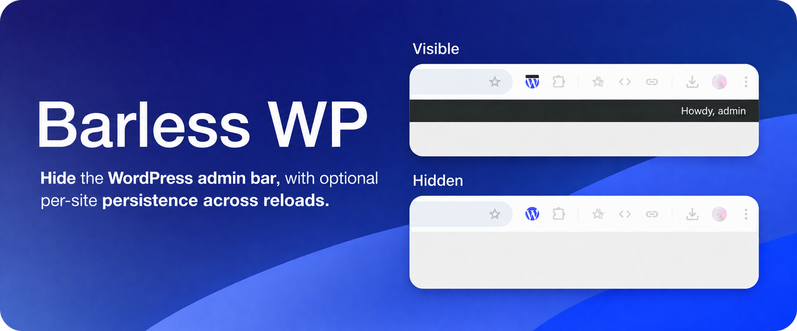

# Barless WP

Hide or restore the WordPress admin bar with one click. A small Chrome extension for
previewing layouts, inspecting pages, and checking your work while staying logged in.

<p>
  <a href="https://chromewebstore.google.com/detail/barless-wp-hide-wordpress/gibnjfgdngfopbbjiicicabafbhgjmca"></a>
  &ensp;<a href="https://alebenassi.com">Website</a>&nbsp;·&nbsp;<a href="https://github.com/ale-benassi/barless-wp/issues">Report&nbsp;a&nbsp;bug</a>
</p>



## Features

- **One-click toggle.** Hide the admin bar and click again to bring it back.
- **Memory per site.** Keep the bar hidden across reloads, with persistence enabled by default.
- **Simple settings.** Turn persistence off to clear saved sites and hide the bar for the current page only.
- **Clear feedback.** The toolbar icon reflects whether the bar is visible or hidden.

## Getting started

1. [Install Barless WP](https://chromewebstore.google.com/detail/barless-wp-hide-wordpress/gibnjfgdngfopbbjiicicabafbhgjmca) and pin it to Chrome's toolbar.
2. Open a WordPress page while logged in, so the admin bar is visible.
3. Click the extension icon to hide the bar. Click it again to restore it.

To change persistence, open the extension's **Options** and toggle
**Remember hidden state on reload**. Turning it off clears the saved site preferences.

Barless WP works on pages containing the standard WordPress admin bar (`#wpadminbar`).
On pages without that bar, or browser pages that block extensions, clicking the icon
briefly shows **N/A**. Changes apply in your browser.

## Privacy and permissions

The extension includes no analytics or third-party scripts and sends no browsing data
to a server. It stores:

- the persistence preference in `chrome.storage.sync`, which Chrome can sync between your browsers;
- saved site origins in `chrome.storage.local`, so the bar stays hidden on the sites you choose.

The `storage` permission saves these preferences. Access to HTTP and HTTPS pages lets
the extension detect the admin bar on WordPress sites across different domains.

Read the [privacy policy](https://barless-wp.alebenassi.com) or its
[source in this repository](privacy-policy/PRIVACY.md).

## Local development

The extension uses plain JavaScript, HTML, and CSS. There is no dependency installation
or build step.

```bash
git clone https://github.com/ale-benassi/barless-wp.git
cd barless-wp
```

1. Open `chrome://extensions` and enable **Developer mode**.
2. Click **Load unpacked** and select the cloned `barless-wp` folder.
3. Visit a WordPress page with an admin bar to try the extension.

After editing the extension, reload it from `chrome://extensions`, then reload the test page.

### Testing changes

Follow the [manual test flow](TEST_INSTRUCTIONS.md). Check hiding and restoring the bar,
reloads with persistence on and off, and behavior on a page without an admin bar.
For changes to saved preferences, also check a second site.

### Packaging

With the `zip` command available, run:

```bash
./package-store.sh
```

This creates `dist/barless-wp-wordpress-admin-bar-toggle-<version>.zip`, using the
version in `manifest.json`. The ZIP includes the extension runtime files and MIT license.
[Store submission notes](STORE_LISTING.md) cover the listing and reviewer information.

### Privacy policy deployment

The policy at `https://barless-wp.alebenassi.com` is served by the Cloudflare Worker
`barless-wp-privacy`, connected to this public repository through Workers Builds.
Builds run in `/privacy-policy`: pushes to `main` deploy with `npx wrangler deploy`,
and pushes to other branches upload a version with `npx wrangler versions upload`.

When changing the policy, update both `privacy-policy/PRIVACY.md` and
`privacy-policy/index.html`. Hosting configuration lives in `privacy-policy/wrangler.jsonc`.

## Contributing

Bug reports, suggestions, and pull requests are welcome. Use
[GitHub issues](https://github.com/ale-benassi/barless-wp/issues) to describe what you
expected, what happened, and how to reproduce it. For larger changes, open an issue first
to discuss the approach.

Keep pull requests focused and include how you tested the change.

## License

Released under the [MIT License](LICENSE).

Created by [Alessandro Benassi](https://alebenassi.com).
